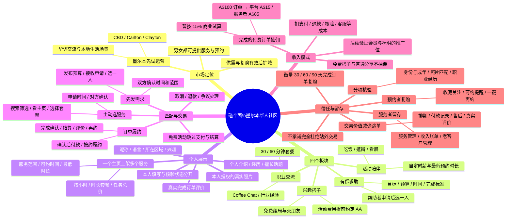

# 碰个面 · 产品思维导图

首发定位：**面向墨尔本华人的时间、经验与兴趣社区**。用户展示自己能提供的服务，或发布想解决的需求；男女都能提供服务和预约。先建立墨尔本供需，再根据真实完成订单、复购与每单成本决定扩城。

打开 [可折叠、可打印的思维导图](product-mindmap.html)。该 HTML 自带样式和交互，无外部运行资源。下面的 Mermaid 版本便于后续修改和在支持 Mermaid 的工具中展示。

分享与展示：[图片版](product-mindmap.png) · [单页 PDF](product-mindmap.pdf)。

## 实施阶段

| 阶段 | 重点 | 开放条件 |
| --- | --- | --- |
| 当前：本机交互原型 | 四个入口、个人展示、多项服务、需求申请、模拟订单与消息 | 数据只在当前浏览器；示例人物与模拟付款不代表真实用户或交易 |
| 下一步：真实社区 | 账号、数据库、照片存储、权限、跨用户消息、订单后台 | 两个真实账号能够完成发布、申请和确认；先免费试用 |
| 收费试点 | 身份与成年核验、支付结算、取消退款、举报客服、真实评价 | 后端确认核验、付款、退款和结算，能够处理爽约与争议 |
| 稳定增长 | 一键再约、日历提醒、内容与关注、收入和老客户管理 | 按场景观察完成率、真实复购与每单成本，再决定原生 App 和扩城 |

15% 是当前原型的商业假设，佣金从服务者订单金额扣除。A$100 的例子未扣支付渠道、税费、退款及运营成本，不代表已发生的收入或净利润。餐饮、门票、交通等开销提前约定。职业交流出售约定时间和主题的经验交流，不代表雇主背书或招聘承诺。

原型可以先用清楚标注的示例展示；真实运营需使用用户本人授权照片，不从照片推断国籍或身份。未完成的认证不显示“已认证”，真实评价只来自符合条件的完成订单。

关联说明：[社区架构](COMMUNITY_ARCHITECTURE.md) · [当前产品与规则](PRODUCT.md) · [信任、减少跳单与留存路线](TRUST_RETENTION_ROADMAP.md)。
